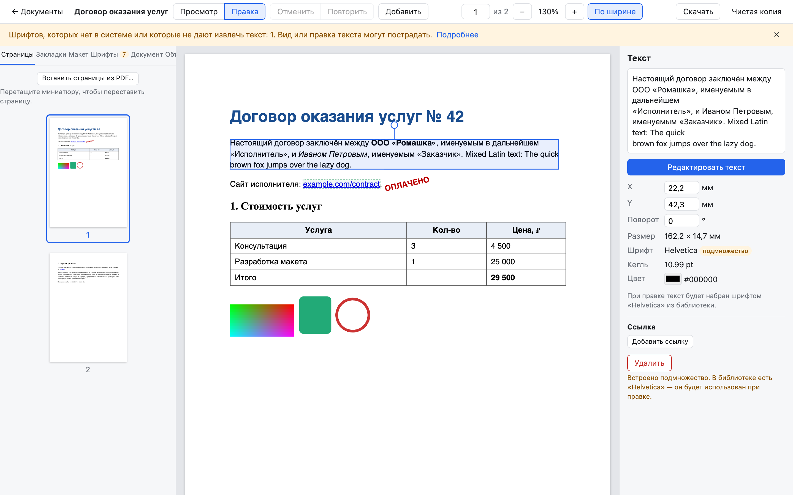

<div align="center">

# PDF Formatter

**Редактор PDF, который работает на вашем компьютере.**
Правит существующие документы аккуратно: меняет то, что вы тронули, и не трогает остальное.

[](LICENSE)


[Скачать](https://github.com/saifutdinov/pdf-formatter/releases/latest) ·
[Возможности](#возможности) ·
[Как это устроено](#как-это-устроено) ·
[Сборка](#сборка-из-исходников)



</div>

## Зачем

- **Документы не покидают компьютер.** Сервер слушает только `127.0.0.1`, интернет не нужен.
  Подходит для договоров, отчётов и всего, что нельзя загружать в онлайн-сервисы.
- **Правка вместо пересборки.** Изменённый блок переписывается прямо в потоке содержимого
  страницы, остальная страница остаётся байт в байт прежней. Шрифты, векторная графика,
  ссылки и закладки не теряются.
- **Текст без искажений.** При правке сохраняется каждый символ исходного блока: двойные
  пробелы, неразрывные пробелы, переносы.
- **Своя библиотека PDF на Go** по спецификации ISO 32000-1, без сторонних PDF-движков на сервере.

## Возможности

| | |
|---|---|
| **Текст** | правка исходных блоков и новые текстовые блоки; жирный, курсив, подчёркнутый, цвет и кегль для части текста (стили слов исходного абзаца сохраняются при правке); выравнивание (и по ширине), интервал, поля, поворот |
| **Объекты** | перемещение, поворот и масштаб мышью или с клавиатуры, перекраска, удаление; прямоугольники, эллипсы, линии; картинки (JPEG, PNG, GIF, WebP) и замена картинок; SVG (свой конвертер в векторный PDF) |
| **Таблицы** | вёрстка по содержимому, ширина столбцов мышью, правка ячеек с Tab и Shift+Tab, шапка, рамки |
| **Страницы** | вставка, удаление, поворот, перестановка перетаскиванием, импорт страниц из другого PDF, поля и «вписать содержимое», колонтитулы с переменными, нумерация страниц (`/PageLabels`) |
| **Навигация** | ссылки на URL и страницы с привязкой к блоку, редактор закладок, закладки из заголовков, страница оглавления с отточиями и номерами |
| **Документ** | метаданные (Info и XMP), очистка истории XMP, миниатюр, JavaScript и вложений |
| **Формы** | заполнение полей AcroForm (текст, многострочный текст, флажки, переключатели, списки) прямо на странице, внешний вид поля перестраивается (кириллица тоже), «Зафиксировать поля» переносит значения в содержимое страниц |
| **Защита** | зашифрованные PDF (RC4, AES-128, AES-256): пароль на открытие, ограничения снимаются паролем владельца; правки сохраняются зашифрованными, «Чистая копия» может снять защиту |
| **Шрифты** | библиотека: встроенные, системные и загруженные; подбор замены для шрифтов документа, предупреждение, если шрифта нет; встраивание подмножества глифов TrueType |
| **Сохранение** | неограниченная отмена и повтор; «Скачать» дописывает изменения к исходному файлу (incremental update), «Чистая копия» пересобирает файл без старых версий |
| **Большие файлы** | страницы подгружаются по мере прокрутки, анализ идёт в фоне, проверено на 500 страницах |

Интерфейс на русском, размеры в миллиметрах, кегль в пунктах.

## Установка

Готовые сборки лежат в [Releases](https://github.com/saifutdinov/pdf-formatter/releases/latest).
Внутри всё нужное, устанавливать ничего не надо.

- **macOS** (Intel и Apple Silicon) — откройте `PDF-Formatter.dmg` и перетащите
  «PDF Formatter» в «Программы». У сборки нет платной подписи Apple, поэтому при первом
  запуске разрешите её: *Системные настройки → Конфиденциальность и безопасность →
  «Всё равно открыть»*.
- **Windows** — распакуйте `pdf-formatter-windows.zip` и запустите `pdf-formatter.exe`.
- **Linux** — распакуйте `pdf-formatter-linux.zip` и запустите `./pdf-formatter`.

Программа откроет редактор в браузере и будет работать в фоне. Чтобы выключить её, нажмите
«Выключить программу» в списке документов. Документы и загруженные шрифты хранятся в папке
приложения: на macOS это `~/Library/Application Support/PDF Formatter`.

### Docker

```bash
docker compose up --build
```

Редактор будет на <http://127.0.0.1:8080>, документы — в `./data`, шрифты Mac из
`~/Library/Fonts` подключаются только для чтения.

## Шрифты

Шрифты лежат в двух папках, подробности в [`fonts/README.md`](fonts/README.md):

- `fonts/free` — PT Sans, Inter, Manrope, Montserrat, Roboto, Space Mono. Свободные лицензии,
  тексты лежат рядом. Входят в репозиторий и в сборки.
- `fonts/licensed` — ваши коммерческие шрифты. Папка в `.gitignore` и в публичные сборки
  не попадает. В библиотеке такие шрифты помечены как «лицензионные».

## Как это устроено

```
Браузер: Preact + pdf.js                      Go: cmd/server (net/http)
  просмотрщик, слой блоков, панели  ◄──────►   API, события (SSE), хранение
                                    JSON, PDF   └─ pdf/  — библиотека
```

- **Исходный файл не меняется.** Документ — это исходник и журнал операций.
  Новый PDF получается из них чистой функцией, отмена убирает последнюю операцию.
- **Блок — это набор операторов** потока содержимого. Правка оборачивает их в `q cm … Q`,
  разрезает `BT/ET` с восстановлением матрицы текста, а при необходимости встраивает
  Form XObject с переименованием ресурсов.
- **На экране те же байты, что уйдут в файл.** pdf.js в браузере отрисовывает именно
  сгенерированную ревизию.
- **Правка помнит свои элементы.** Если новая версия программы разобьёт страницу на блоки
  иначе, старые правки останутся на том же содержимом.

Библиотека `pdf/` не зависит от сервера и подойдёт для своих инструментов:

| Пакет | Что делает |
|---|---|
| `pdf/cos` | объекты, лексер и парсер, xref-таблицы и потоки, объектные потоки, восстановление битых файлов, фильтры (Flate, LZW, ASCII85, ASCIIHex, RunLength, предикторы), шифрование (стандартный обработчик, ревизии 2–6), incremental update и чистая запись |
| `pdf/content` | разбор и запись потоков содержимого без потерь, интерпретатор графического и текстового состояния, Form XObject |
| `pdf/font` | простые и составные шрифты, CMap и ToUnicode, метрики стандартных 14 шрифтов, встраивание TrueType как Type0 с подмножеством глифов |
| `pdf/layout` | разбор страницы на блоки: текст (строки, абзацы), картинки, векторные группы |
| `pdf/edit` | журнал операций, правка на месте, свои объекты, таблицы, страницы, колонтитулы, оглавление |
| `pdf/meta`, `pdf/nav` | метаданные Info и XMP, ссылки, закладки, нумерация страниц |
| `pdf/form` | поля форм AcroForm: имена, типы, значения, варианты, виджеты |
| `pdf/svg` | SVG в Form XObject |

## Сборка из исходников

Нужны Go 1.27 и Node.js 22.

```bash
(cd web && npm ci && npm run build)       # интерфейс → web/dist
go run ./cmd/server                       # http://127.0.0.1:8080
```

Режим разработки интерфейса с перезагрузкой: `go run ./cmd/server` в одном терминале и
`cd web && npm run dev` в другом.

Сборки для macOS, Windows и Linux складываются в `dist/`:

```bash
./scripts/release.sh                 # только свободные шрифты — можно публиковать
LICENSED=1 ./scripts/release.sh      # плюс fonts/licensed — только для себя
```

### Тесты

```bash
go test ./...                        # быстро, локально
docker build --target test .         # то же, и каждый выходной файл проверяет qpdf --check
```

Тестовые PDF из Chrome, Quartz и cairo пересобираются скриптом `testdata/make-corpus.sh`.

## Ограничения

- Не поддерживаются распознавание текста, шифрование по сертификату, создание новых полей формы и поля с JavaScript-форматированием.
- Таблицы без объединения ячеек и без переноса на следующую страницу.
- Шрифты CFF встраиваются целиком.
- Сборки не подписаны сертификатами Apple и Microsoft, поэтому система предупредит о
  неизвестном разработчике.

Планы и принятые решения — в [ROADMAP.md](ROADMAP.md).

## Лицензия

[GNU AGPL-3.0](LICENSE). Пользоваться, изменять и распространять можно свободно. Если вы
распространяете изменённую версию или запускаете её как сетевой сервис, откройте исходный
код своих изменений под той же лицензией.

Сторонние компоненты (pdf.js, Preact, golang.org/x, шрифты) распространяются под своими
лицензиями: [THIRD_PARTY_LICENSES.md](THIRD_PARTY_LICENSES.md).
